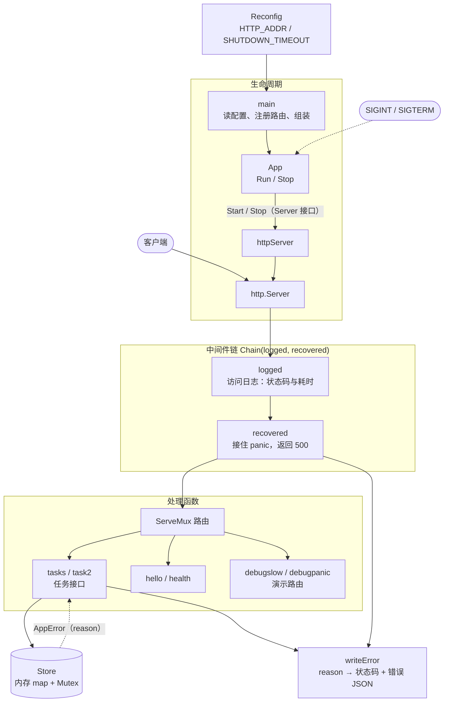
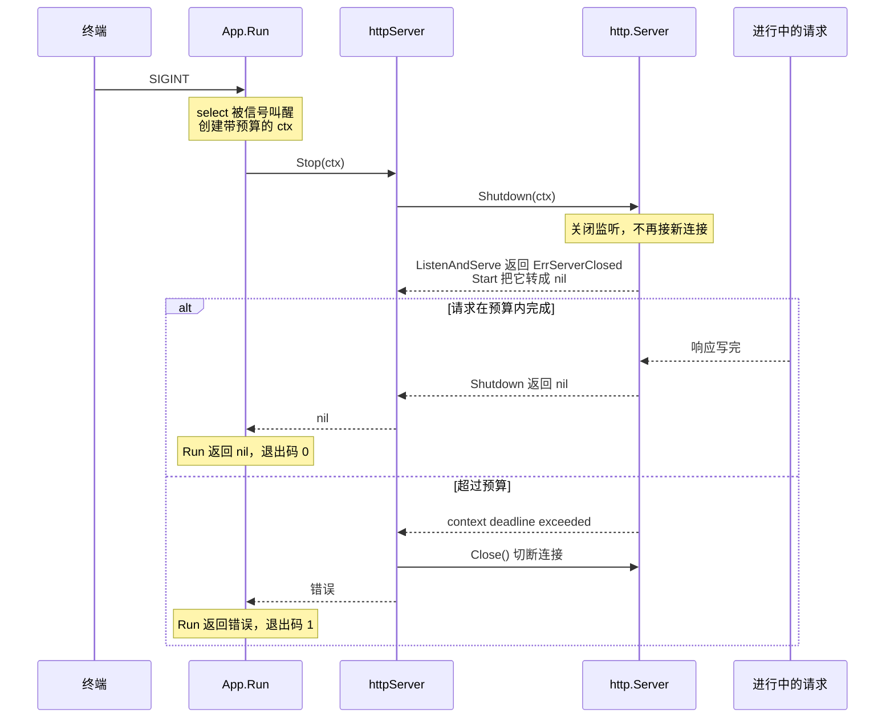

# mini-kratos

参考 [Kratos](https://github.com/go-kratos/kratos) 的设计思路，用 Go 标准库从零搭的一个 HTTP 服务骨架。它是一个学习项目：目的是弄清楚中间件链、统一错误、优雅关闭和生命周期管理这些框架能力是怎么来的，而不是提供一个可用于生产的框架。

没有第三方依赖，全部代码在 `main.go`，测试在 `main_test.go`。

## 功能

- **任务接口**：创建和查询任务，数据存在内存里，用互斥锁保证并发安全。
- **中间件链**：访问日志和 panic 恢复两个中间件，通过 `Chain` 组合。
- **统一错误**：业务层只返回带 `reason` 的错误，HTTP 状态码统一在一处决定，错误响应是固定结构的 JSON。
- **优雅关闭**：收到 SIGINT 或 SIGTERM 后，在时间预算内等进行中的请求做完；超时则强制关闭并以非 0 退出码结束。
- **生命周期管理**：`Server` 接口加 `App`，由 `App` 负责启动、等待信号和关闭，自身不依赖 `net/http`。
- **配置**：监听地址和关闭预算从环境变量读取，启动时校验，写错立即失败。

## 架构

一个请求经过的路径，以及各部分之间的关系：



按下 Ctrl+C 之后发生的事：



## 运行

需要 Go 1.26 或更高版本（`go.mod` 声明的是 1.26.5）。

```bash
go build -o bin/mini-kratos . && ./bin/mini-kratos
```

启动后默认监听 `:8080`。

### 配置

| 环境变量 | 默认值 | 说明 |
|---|---|---|
| `HTTP_ADDR` | `:8080` | 监听地址 |
| `SHUTDOWN_TIMEOUT` | `5s` | 优雅关闭最多等多久。必须带单位且大于 0，例如 `2s`、`500ms` |

```bash
HTTP_ADDR=:9090 SHUTDOWN_TIMEOUT=2s ./bin/mini-kratos
```

`SHUTDOWN_TIMEOUT` 写成 `abc`、`5`、`0s` 或 `-1s` 时，程序会报出变量名和原值并以退出码 1 结束，不会开始监听。

## 接口

| 请求 | 响应 |
|---|---|
| `GET /hello` | 200，纯文本 |
| `GET /healthz` | 200，`{"status":"ok"}` |
| `POST /tasks`，正文 `{"title":"买菜"}` | 201，`{"id":1,"title":"买菜"}` |
| `POST /tasks`，非法 JSON 或空标题 | 400，错误 JSON |
| `GET /tasks/{id}` | 200，任务 JSON；不存在返回 404；`id` 不是正整数返回 400 |
| `GET /debug/slow?d=4s` | 等待指定时长后返回 200，用来演示优雅关闭；缺省 3s |
| `GET /debug/panic` | 处理函数 panic，被恢复中间件接住，返回 500 |

错误响应的结构：

```json
{"code":404,"reason":"NOT_FOUND","message":"不存在数据"}
```

`reason` 目前有三种：`NOT_FOUND`（404）、`INVALID_ARGUMENT`（400）、`INTERNAL`（500）。未注册的路径和不支持的方法由标准库路由器返回纯文本的 404、405。

每个请求结束后会打一行访问日志：

```
INFO 消息 method=GET path=/tasks/999 status=404 duration=21.25µs
```

## 演示优雅关闭

需要两个终端。

终端 A 启动服务：

```bash
./bin/mini-kratos; echo "退出码=$?"
```

终端 B 发一个 4 秒的慢请求，然后马上回终端 A 按 Ctrl+C：

```bash
curl -i "http://localhost:8080/debug/slow?d=4s"
```

预期：终端 B 约 4 秒后仍然收到 `200 OK` 和 `slow done`；终端 A 先打印"收到退出的信号，开始关闭"，等这次请求的访问日志出现后立即退出，`退出码=0`。

把预算调短可以看到超时的情形：

```bash
SHUTDOWN_TIMEOUT=2s ./bin/mini-kratos; echo "退出码=$?"
```

```bash
curl -i "http://localhost:8080/debug/slow?d=6s"
```

预期：按 Ctrl+C 约 2 秒后进程退出，日志含 `context deadline exceeded`，`退出码=1`；curl 报 `Empty reply from server`。

## 测试

```bash
go test -race ./...
```

共五个测试：健康检查、中间件执行顺序、panic 恢复、配置读取（表驱动）、服务启动失败时 `App` 返回该错误并调用 `Stop`（用假 `Server` 实现，不监听端口）。

信号退出、在途请求和关闭超时目前只有上面的手动演示，没有自动化测试。

## 代码结构

| 位置 | 内容 |
|---|---|
| `Reconfig`、`config` | 读取并校验环境变量 |
| `Server` 接口、`httpServer` | 生命周期接口，以及 `http.Server` 对它的实现 |
| `App`、`AppServer` | 启动全部服务、等待信号或启动失败、带预算关闭 |
| `Middleware`、`Chain`、`logged`、`recovered` | 中间件类型、组合函数和两个中间件 |
| `AppError`、`writeError` | 业务错误与状态码映射 |
| `Store`、`tasks`、`task2` | 内存存储与任务接口的处理函数 |

## 尚未实现

- 请求超时与 context 在处理函数和存储层之间的传递
- 按 Kratos 的风格拆分成多个包
- gRPC
